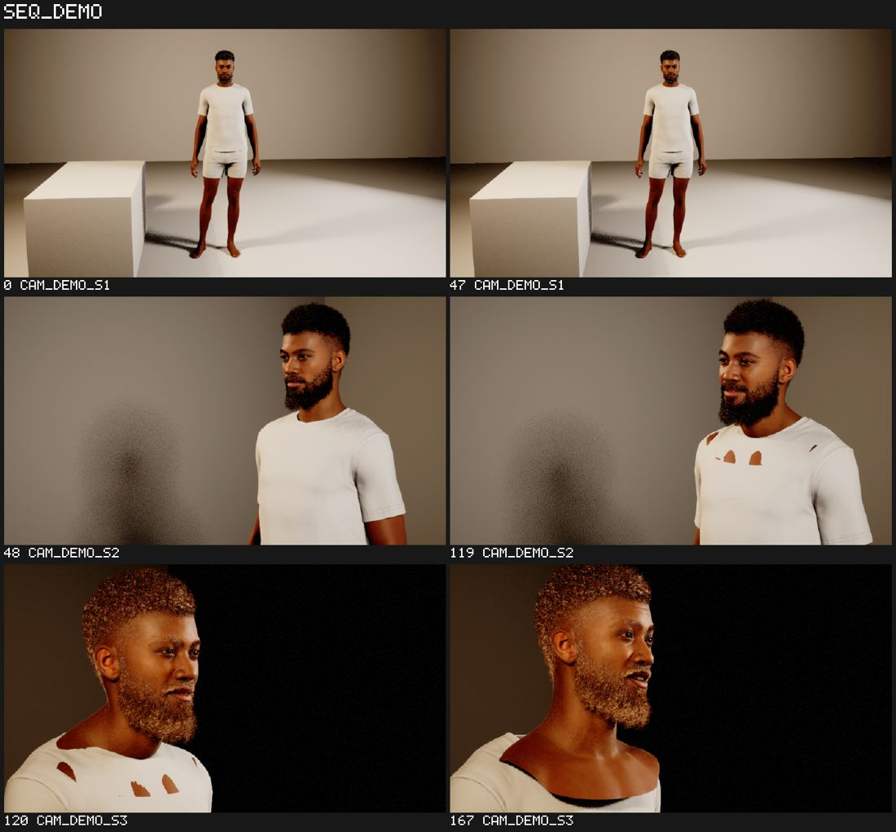
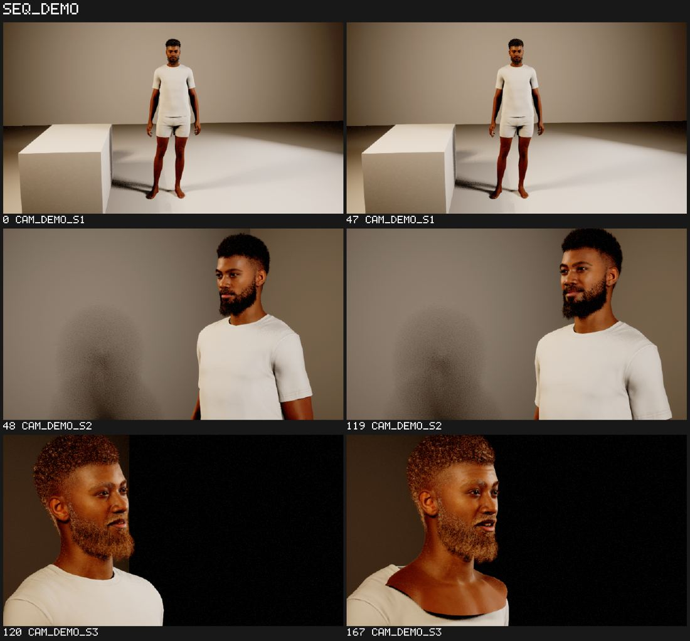

# DAY1-REPORT: the Unreal helpers on a real GPU box

Box: i-0f7a6ac044b75e922 (g6.4xlarge, 1x L4 24 GB, Ubuntu 22.04, ap-south-1b), UE 5.8.4 source build, project
HostStudio, from `main` 31c57577. Runs: `film-ue selftest` in the planned order (`film-ue selftest plan`), then the
demo (examples/unreal/demo). Fixes go to `fleet/agent-13/day1-<area>` off main, merged by agent-10.

Live table (newest result per area; times are wall clock on the box):

| # | area | result | time | failures | fix (branch / commit) | rerun | stills |
|---|---|---|---|---|---|---|---|
| 0 | first-run (agent-07) | OK except dx | ~19:20 | dx: view.still | (dx row) | platform 48/0 | |
| 1 | platform | OK 48/0 (first-run) | 60 s | | | | |
| 2 | dx | OK 32/0 (bridge + client) | 13 s | view.capture writes; dx_client delete refused | day1-view 72a80945; day1-dx f8195902 (GC before delete) | OK 32/0 | |
| 3 | assets | 62/1 | 119 s | only fab.login: Fab needs its own sign-in (FabScript loaded) | day1-mat bb6d57c0; day1-dx da9fa76f | 62/1 | |
| 4 | layout | OK 36/0 | 11 s | (was: view.capture error) | day1-view | OK 36/0 | stills in report |
| 5 | mh | ERROR after 25/0 -> 36/2 (melanin skipped, kali-only) | 79 s | no groom has instance params before assembly (Hair Melanin, Eyebrows Whiteness: item_params empty live); 'hair worn' changed False | agent-04 (probe running) | 36/2 | |
| 6 | anim | 22/5 | 48 s | head curves do not turn the head (0 cm); face.alive; describe.face_curves; clavicle twist axis | agent-01 (task assigned) | 22/5 | |
| 7 | seq | 42/3 | 25 s | after seq.eval the camera's transform track re-plans (ST_seq_CamA/transform differs) | day1-seq f36288d1; agent-06 (fake-bounded) | 42/3 | |
| 8 | cam | 43/9 -> rerunning c83bf93e | 31 s | filmback aspect of stills, convergence, coverage names, shot.plan up_to_date with cameras gone | agent-11 day1-cam c83bf93e | rerunning | |
| 9 | render | 25/2 | 53 s | MRQ editor library missing (new-process/cmdline executors); cancelled job reports ok; (fixed: JPEG frames are .jpeg) | day1-render 48f97794 | 25/2 | |
| 10 | qa | 30/2 | 28 s | default capture format: RTF_RGBA8_SRGB matches the viewport better (SSIM 0.67 vs 0.59) | agent-09 | 30/2 | |
| 11 | audio | OK 17/0 | 10 s | | | | |
| 12 | env | OK 56/0 | 37 s | (was: no lighting_channels on SkyLight; display read 0..255; capture stored linear) | agent-08 env-day1 8eb7dcb9 + 71520e48 | OK 56/0 | |
| 13 | foliage | OK 20/0 | 30 s | | | | |
| 14 | pose | ERROR 0/0 | 7 s | anim.py:1008 rig_keys: the engine made no control rig track | needs an owner (agent-01 has no task) | | |
| 15 | wp | OK 17/0 | 5 s | unreal.Box(min, max, is_valid) refused (FBox native make: 2 args) | day1-wp 8f9320ac | OK 17/0 | |
| D | demo | CONVERGES (2nd plan 0 to change); 168 frames rendered | stage 1 ~6 min (rig 86 s, textures 19 s, build 251 s) | build raced the textures; enum as string; /srv/film unwritable; no voice (espeak-ng on the box); stale shot hash; JPEG frames .jpeg; qa.review counted cameras as overlaps | day1-demo bd2c487a; day1-render 688a2b3b; day1-dx 1641cf31 (save the level before a scratch level); agent-09 still-srgb; agent-11 | converged | /srv/ue/demo/out/render, qa |

## Log

- 19:28 batch 1 (assets..wp, kali reports/192856-assets): view.capture failed every still (EditInstanceOnly
  ShowOnlyActors/HiddenActors; then a stale cached render target); seqcore collapsed every section range; plus
  area-specific live API gaps (see rows). audio, foliage OK first time.
- 19:34 batch 2 (dx qa layout env, reports/193354-dx) with day1-view installed: layout OK, dx bridge OK, qa 26/6.
- 19:40 batch 3 (seq render cam qa anim env) with day1-seq installed: seq 42/2, render 20/1, cam 27/14 (projection
  ~3x too wide: the capture's FOV?), qa 30/2. editor.api_names (242 checked): missing EMetaHuman, MoviePipelineEditor-
  BlueprintLibrary, UsdStageImportOptions.
- 14:05 UTC editor restart for agent-07's FabScript (loaded). Batch 4 (assets mh wp pose dx anim render): wp OK, dx OK
  32/0; assets and mh could not create their scratch level (left by batch 1) -> day1-dx da9fa76f.
- 14:12 UTC batch 5 (assets mh render cam env anim qa seq) with every fix so far installed.
- 14:12-14:20 UTC batch 5 (all fixes installed): see rows. Probes: the capture's fov_angle applies (90 -> 33 reads back).
- 14:25 UTC demo stage 1 on Epic's real cloud: preset, rig, textures OK; mh.build said a cloud request was still
  running: retried after 30 s. Reports for owners: fleet/agent-13/day1-reports.
- 14:30 UTC the demo applied end to end (MetaHuman from the real Epic cloud, set, lights, speech-to-face from an
  espeak-ng line, sequence, audio, 3 shots) and a second plan was empty. The level had been reloaded unsaved by a
  selftest in between (cameras lost, shot hash kept): fixed by saving the open level before any scratch level
  (day1-dx 1641cf31) and by shot.plan checking its cameras (agent-11).
- 14:40 UTC preview render: 168 JPEG frames in /srv/ue/demo/out/render; the job reported 0 (looked for .jpg): fixed.
- 14:50 UTC env OK 56/0 with agent-08's branch.

## The demo, seen

The cut as a contact sheet (2 stills per shot: WS, MCU with a push-in, CU), first pass:

What the numbers missed and the eye caught: skin through the shirt (frames 119, 120) and the collar off the chest
(167): the face, played by Sequencer, did not follow the body; and the hair/beard read orange-white in the CU.
After day1-demo d6c24fa9 (anim.bake_follow, r.HairStrands.SkyLighting 0, penetration in the review):

The shirt holds in 119 and 120; at 167 the collar still slips (the face's own neck motion at the end of the line:
open), and the CU's warm hair is the 4300 K rim light (a look choice, not a bug).

## HANDOFF (agent-13, 2026-11-05 ~15:00 UTC)

Green on the box (latest runs, code = fleet/agent-10/day1 + the branches below): platform 48/0, dx 32/0, layout 36/0,
seq 45/0, cam 52/0, qa 32/0, audio 17/0, env 56/0, foliage 20/0, wp 17/0. The demo applies end to end and converges
(a second plan has nothing to change), rendered preview + final (168 frames), review passes (warnings only).

Open, and why:
- assets 62/1: fab.login. Fab needs its own Epic sign-in; the device-code URL is redacted in the log and goes to a
  headless browser, so only the exchange-code route works (an operator gives a one-time code; agent-07's
  `film-ue epic-login --exchange-code-cmd` / editor.epic_exchange_code). Asked the orchestrator.
- render 25/2: the new-process / command-line executors need MoviePipelineEditorBlueprintLibrary, which this build's
  editor never exposes (unreal.load_module('MovieRenderPipelineEditor') does not bring it); 'cancelled job reports
  cancelled' got ok. agent-05 has no task: needs an owner.
- anim 22/5 and pose (rig_keys: no control rig track): agent-01 (task assigned; reports on fleet/agent-13/day1-reports).
- mh 36/2: no groom has instance parameters before the instance is assembled (probe output on day1-reports);
  agent-04 is fixing the op; for this run the melanin/redness/whiteness steps were skipped (kali-only patch).
- demo: frame 167 the collar still slips (the face's neck motion at the end of the line); the CU's warm hair is the
  4300 K rim (a look choice). The review's penetration check is now on.

How I drive the box (all from kali, 192.168.29.222, user nikhil; the fleet secret kali-ssh is a PASSWORD: use
SSH_ASKPASS, never print it):
- Checkout: /tmp/fleet-agent-13-ue (tools, unreal, examples, docs rsynced from a local merge of fleet/agent-10/day1 +
  the fix branches being tested). Env: AWS_PROFILE=nani AWS_REGION=ap-south-1 FILM_UE_CONF_DIR=/tmp/fleet-agent-13-ue/conf
  (conf = agent-07's film-ue.json + `film-ue set --local-port 18775`: agent-07's tunnel holds 18765).
- After changing code: `cd tools && uv run film-ue install` (retry once: the first can fail while the old bridge goes).
- Selftests: `/tmp/fleet-agent-13-ue/run.sh <areas...|all>` (film-ue selftest --keep-going into
  /tmp/fleet-agent-13-ue/reports/<time>-<first area>/, log beside it); `python3 /tmp/fleet-agent-13-ue/why.py <dir> [areas]`
  prints each failure and error in one line.
- Demo: `uv run film-ue apply ../examples/unreal/demo/demo.yaml`, review `.../70-qa.yaml`, render `.../80-render.yaml
  [--set preset=final]`; outputs in /srv/ue/demo/out (render/, qa/, stills*/); the voice line /srv/ue/demo/demo_line.wav
  (espeak-ng on the box).
- Pictures: `film-ue view stills --sequence /Game/_Demo/SEQ_Demo --out-dir /srv/ue/demo/out/stillsN --per-shot 2`, then
  `film-ue pull .../sheet.png /tmp/...` and LOOK at it.
- Read-only engine source on the box (the source box is gone): /srv/ue/engine/Engine/Source and Plugins, through SSM
  (`aws ssm send-command ... AWS-RunShellScript`; my wrapper /work/ssm.sh).
- Slot protocol: only one driver; agent-07 gave me the slot after first-run ('slot to agent-13') and takes it back at
  16:55 UTC for the DDC save ('slot to agent-07'); the box's TTL is 17:27 UTC.
- Reports for owners: fleet/agent-13/day1-reports (JSON per area). Fix branches: fleet/agent-13/day1-{view,seq,dx,wp,
  mat,render,demo}, merged by agent-10.

